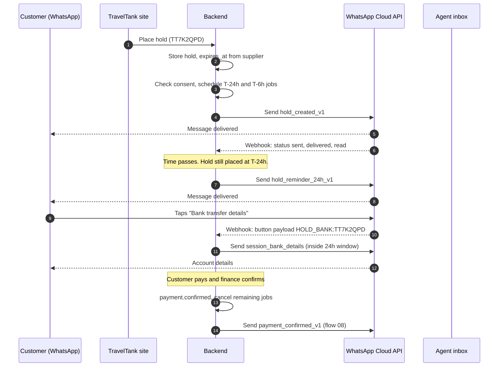

# Flow 07: Hold reminders

Status: draft for review. Prototype scenario: **A 72-hour hold that does not slip away** (`#hold`).

## 1. Summary

When a customer places a flight on hold, TravelTank confirms it on WhatsApp and reminds them 24 hours and 6 hours before the hold ends. Each message offers ways to pay or to talk to a Travel Shark. If the hold ends unpaid, one final message says so and offers to check the price again.

Scope: flight holds only. The site's Hold booking option reads "Bookings will be released in 72 hours if no payment received". Hotels and holidays are out of scope.

## 2. Trigger

| Event | Source | Starts |
|---|---|---|
| `hold.created` | Booking service, when a hold is confirmed by the supplier | Immediate confirmation, then the reminder schedule |

Related events that stop the schedule are listed in section 7.

## 3. Preconditions

All of these must be true to send any message in this flow:

1. `customer.whatsapp_consent.opted_in = true` and `opted_out_at` is empty.
2. The consent record has a phone number in E.164 form, matching the number on the booking contact details.
3. The booking has a hold with a supplier-confirmed `expires_at`. Do not assume 72 hours.
4. The hold status is `placed`. Never send for `paid`, `cancelled` or `expired`.

If consent is missing, do nothing on WhatsApp. The site already sends the confirmation email.

Consent can come from two places (see flow 05 for the first):

- The WhatsApp row on the contact details step.
- The reminder row under Hold booking on the payment step. Ticking it creates the consent record, with `source = "checkout_hold_row"`.

## 4. Sequence



## 5. Messages

Templates are defined in full in [`templates/templates.yaml`](../templates/templates.yaml). Summary:

| # | Name | When | Category `[confirm]` | Buttons |
|---|---|---|---|---|
| 1 | `hold_created_v1` | Immediately after the hold is placed | Utility | Pay by card, Bank transfer details, Talk to a Shark |
| 2 | `hold_reminder_24h_v1` | 24 hours before `expires_at` | Utility | Pay by card, Bank transfer details |
| 3 | `hold_reminder_6h_v1` | 6 hours before `expires_at` | Utility | Pay now, Ask a Shark |
| 4 | `hold_expired_v1` | When the hold is released unpaid | Utility | Check price again, Talk to a Shark |

Template 4 is new. It is not in the prototype.

### Session messages (free-form, only inside the 24-hour window)

A customer tapping a button or replying opens a 24-hour window. Inside it, these can be sent without a template.

| Name | Sent when | Type |
|---|---|---|
| `session_pay_link` | `HOLD_PAY_CARD` or `HOLD_PAY_NOW` tapped | Interactive CTA URL |
| `session_bank_details` | `HOLD_BANK` tapped | Text with quick-reply buttons |
| `session_handoff_ack` | `HOLD_SHARK` tapped | Text |
| `session_hold_ended` | A button is tapped after the hold ended | Text with quick-reply buttons |
| `session_already_paid` | A pay button is tapped after payment | Text |

Copy for each:

- `session_pay_link`: "Your card payment is *₦5,798,324*, which includes the ₦124,817 card fee. Tap below to pay securely." Button: "Pay ₦5,798,324". The amounts come from the payment step on the site. The fee must be read from the payment service, never typed.
- `session_bank_details`: the account block from flow 08, with the booking reference as the narration.
- `session_handoff_ack`: "Thanks Tunde. A Travel Shark will pick this up now. Your booking *TT7K2QPD* is attached."
- `session_hold_ended`: "Your hold on *TT7K2QPD* has ended and the fare was released. Want us to check the price again?" Buttons: Check price again, Talk to a Shark.
- `session_already_paid`: "Good news, *TT7K2QPD* is already paid. Your tickets are being issued."

## 6. Customer replies

All quick-reply taps on templates arrive as webhook messages of type `button` with the payload set when the template was sent. See [`payloads/webhook.button_reply.json`](../payloads/webhook.button_reply.json).

| Payload | Action |
|---|---|
| `HOLD_PAY_CARD:{ref}` | Check the hold is still `placed`. Create a card payment session with the payment service. Send `session_pay_link`. |
| `HOLD_PAY_NOW:{ref}` | Same as `HOLD_PAY_CARD`. |
| `HOLD_BANK:{ref}` | Check the hold. Send `session_bank_details`. Record that the customer chose bank transfer. |
| `HOLD_SHARK:{ref}` | Open a case in the agent inbox with the booking attached and tag `hold`. Send `session_handoff_ack`. |
| `HOLD_RECHECK:{ref}` | Re-price the itinerary. Reply with a new fare if available, or hand off to an agent. |
| Free text | Route to the agent inbox with the booking attached. Do not auto-reply, other than the handoff acknowledgement when no agent is active. |
| `STOP` (any case) | Set `opted_out_at`. Cancel all pending jobs for this customer. Send one confirmation: "You won't get WhatsApp messages from us any more. You can switch them back on in My Account." |
| Image or document | Route to the agent inbox. (Receipts are handled in flow 08.) |

If the hold is no longer `placed` when a button is tapped, send `session_hold_ended` or `session_already_paid` as appropriate. Never create a payment for a hold that has ended.

## 7. Scheduling and idempotency

### When messages fire

| Message | Send time | Skipped when |
|---|---|---|
| `hold_created_v1` | Immediately | No consent |
| `hold_reminder_24h_v1` | `expires_at` minus 24h | Less than 2 hours would separate it from `hold_created_v1`, or the hold is not `placed` |
| `hold_reminder_6h_v1` | `expires_at` minus 6h | Less than 2 hours would separate it from the previous message, or the hold is not `placed` |
| `hold_expired_v1` | At `expires_at` plus a short delay | The hold is not `expired` (for example it was paid or cancelled) |

Because the schedule is based on the supplier's `expires_at`, a hold shorter than 72 hours skips the reminders that no longer make sense.

### Events that cancel pending jobs

`payment.confirmed`, `hold.cancelled`, `hold.expired` (after sending `hold_expired_v1`), `customer.opted_out`.

### Idempotency

- Idempotency key: `{booking_ref}:{template_name}`.
- At most one send per key. If a job runs twice, the second finds the key stored and does nothing.
- The job re-reads the hold status immediately before sending, not when it was scheduled.
- Store the WhatsApp message ID (`wamid...`) returned by the send call against the key.

### Quiet hours `[confirm]`

Decision needed: whether reminders may go out overnight. Proposal: if a send time falls between 23:00 and 06:00 WAT, send at 22:30 the previous evening instead, never later, because later would shorten the warning.

## 8. Failure handling

| Case | Handling |
|---|---|
| Send call returns a 5xx or times out | Retry up to 3 times with exponential backoff (1 min, 5 min, 15 min). Keep the same idempotency key. |
| Webhook status `failed` with a "not a WhatsApp user" error `[confirm exact code]` | Mark `whatsapp_reachable = false` for that number. Stop the schedule. Rely on the email already sent. Show a prompt in My Account to update the number. |
| Webhook status `failed` for other reasons | Log with the error code. Retry once after 15 minutes, then raise an alert if it still fails. |
| Number blocked the business | Treat as opt-out. Set `opted_out_at`. Do not retry. |
| Webhook delivery to TravelTank fails | Acknowledge with HTTP 200 quickly and process asynchronously. Meta retries failed webhooks, so handlers must be idempotent on the `wamid`. |
| Template rejected or paused | Alert the owner. The flow falls back to email only. |

## 9. Data and consent

Stored per customer:

- `whatsapp_consent`: `opted_in`, `opted_in_at`, `source`, `wording_version`, `phone_e164`, `opted_out_at`.
- `whatsapp_reachable` and `last_failure_code`.

Stored per message:

- `booking_ref`, `template_name`, `idempotency_key`, `wamid`, `status` (sent, delivered, read, failed), timestamps for each, and the error code if any.

Retention and access rules for this data need a data protection review before launch `[confirm with TravelTank]`.

## 10. Metrics

Log these as events so the owner can measure uplift:

| Event | Fields |
|---|---|
| `wa.message.sent` | booking_ref, template_name |
| `wa.message.delivered` / `read` / `failed` | booking_ref, template_name, error_code |
| `wa.button.tapped` | booking_ref, payload action |
| `hold.paid_after_reminder` | booking_ref, template of the last message before payment, minutes between |

Headline measures: hold-to-paid rate for opted-in against not opted-in holds, share of payments within 24 hours of a reminder, and reminder delivery rate.

## 11. Acceptance tests

```gherkin
Scenario: Hold confirmation is sent to an opted-in customer
  Given an opted-in customer with number 2348012345678
  And a hold TT7K2QPD that expires in 72 hours
  When the hold is placed
  Then hold_created_v1 is sent once to 2348012345678
  And the message shows the ref, route, total and expiry in Lagos time
  And two reminder jobs are scheduled

Scenario: Customer who did not opt in gets nothing
  Given a customer with no WhatsApp consent
  When a hold is placed
  Then no WhatsApp message is sent and no jobs are scheduled

Scenario: 24-hour reminder
  Given a placed hold with 24 hours left
  When the reminder job runs
  Then hold_reminder_24h_v1 is sent once
  And running the job again sends nothing

Scenario: Paid hold stops reminders
  Given a placed hold with a pending 6-hour reminder
  When payment.confirmed arrives
  Then the 6-hour reminder is cancelled and not sent

Scenario: Short hold skips the 24-hour reminder
  Given a hold that expires in 20 hours
  When the hold is placed
  Then hold_created_v1 is sent
  And no 24-hour reminder is scheduled
  And a 6-hour reminder is scheduled

Scenario: Card button on a live hold
  Given a placed hold TT7K2QPD
  When the customer taps "Pay by card"
  Then a payment session is created
  And session_pay_link is sent with the total including the card fee

Scenario: Button tapped after the hold ended
  Given an expired hold TT7K2QPD
  When the customer taps "Pay by card"
  Then no payment session is created
  And session_hold_ended is sent

Scenario: Opt out
  Given an opted-in customer with pending jobs
  When the customer sends "STOP"
  Then opted_out_at is set
  And all pending jobs are cancelled
  And one confirmation is sent
```

## 12. Open questions

| # | Question | Owner |
|---|---|---|
| 1 | Is the Utility category accepted for all four templates? The 6-hour message has a service tone. | Tech partner, then Meta review |
| 2 | Quiet hours rule (section 7). | TravelTank |
| 3 | Do we send `hold_expired_v1` at all, or is it too much? | TravelTank |
| 4 | Card fee wording: the site shows the fee on the payment step. Is quoting it in chat acceptable? | TravelTank |
| 5 | Response targets for Shark handoff outside agent hours, even though the site promises 24/7. | TravelTank |
| 6 | Multi-city and one-way itineraries: the route summary variable covers them, but confirm the wording reads well. | Design |
| 7 | Which provider hosts the agent inbox, and how booking context is attached. | Tech partner |
